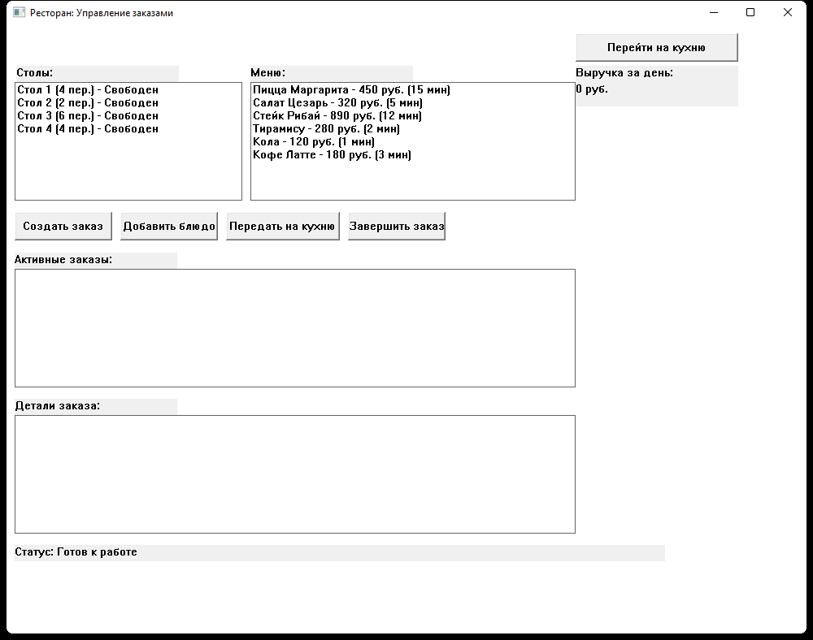
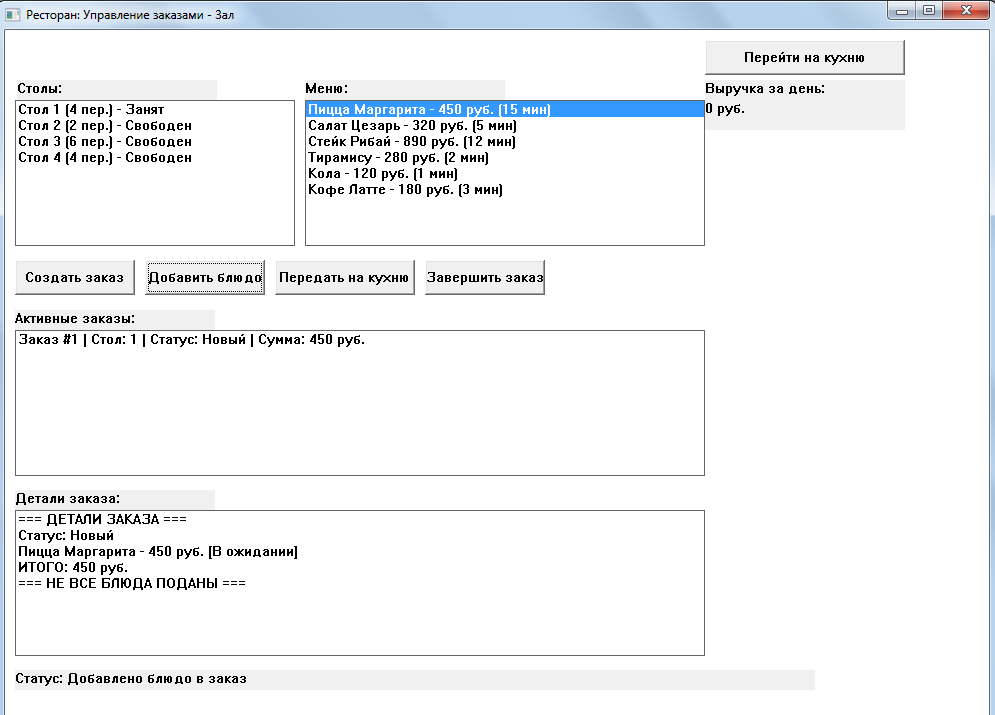
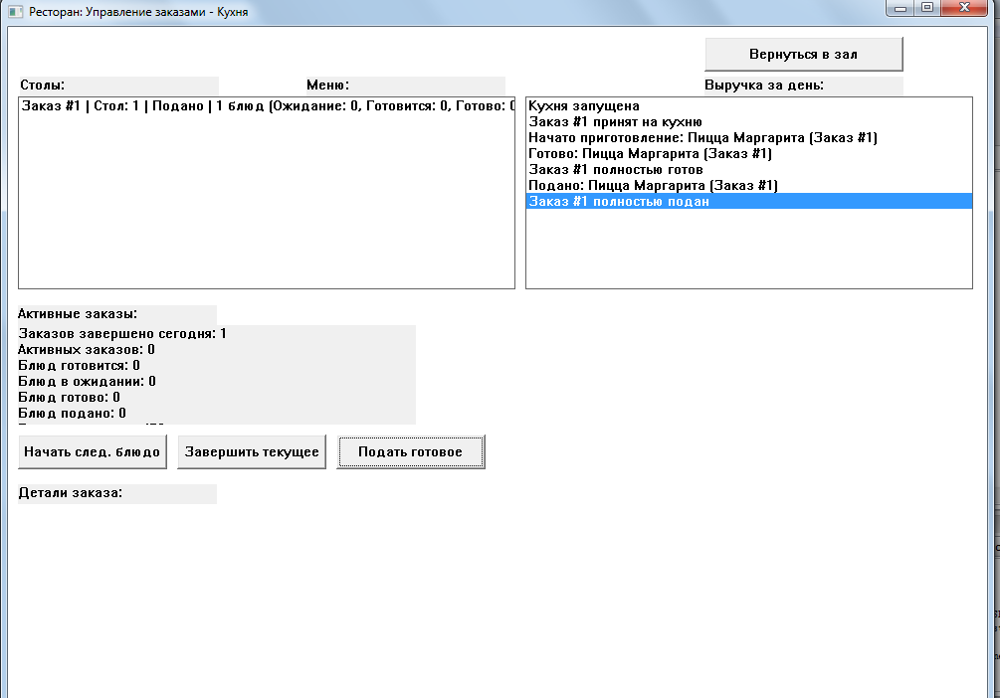
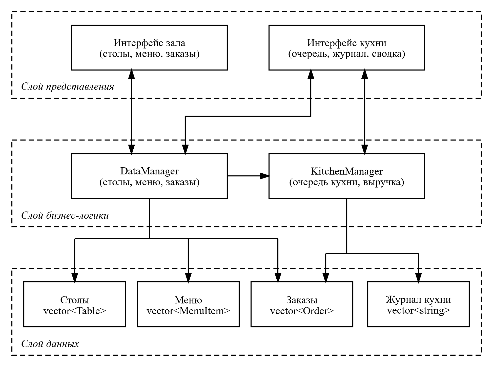
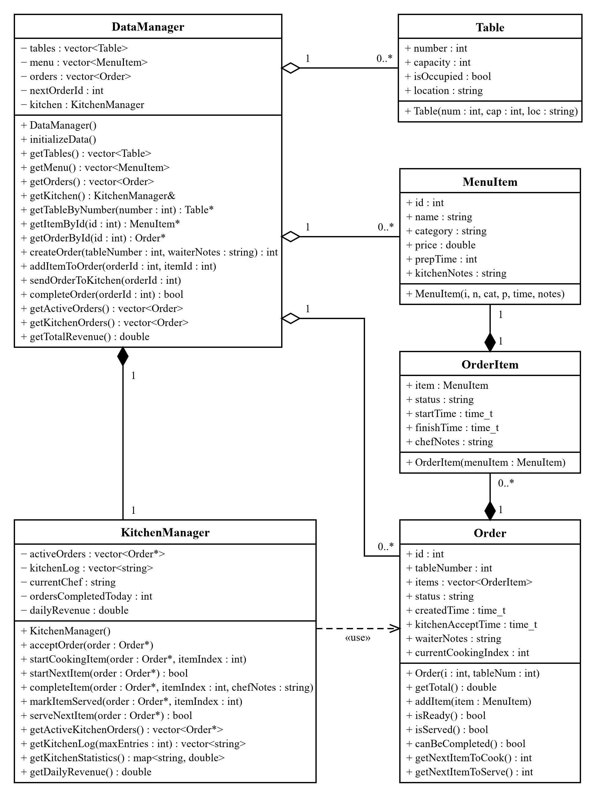
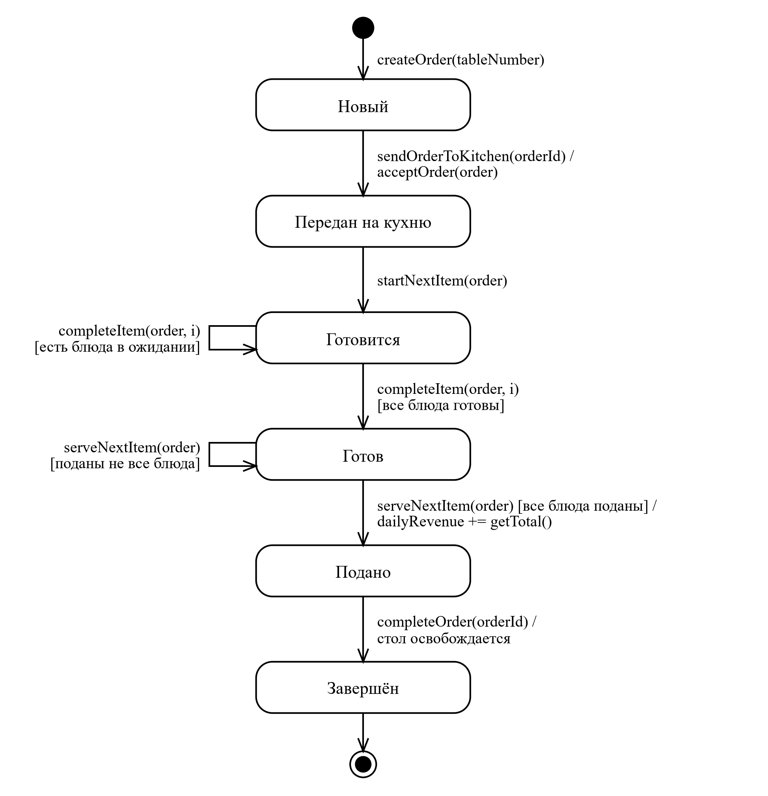
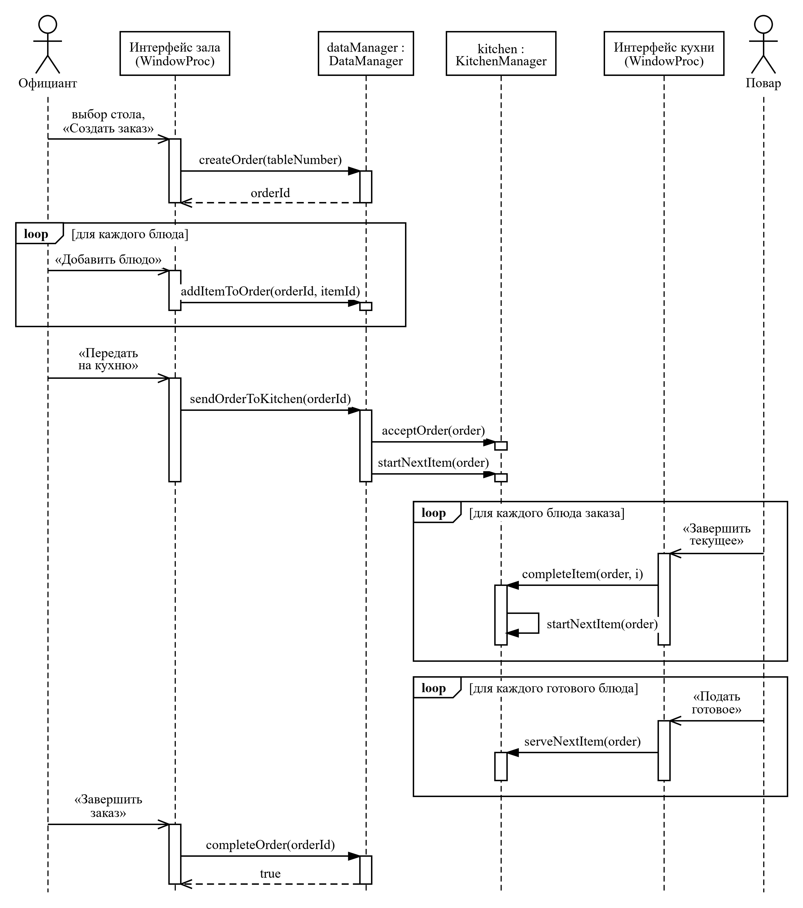

# 🍽️ Ресторан: управление заказами — зал и кухня

Курсовая работа по дисциплине **«Программирование»** (ТулГУ, Институт прикладной математики и компьютерных наук, 2025): прикладной программный продукт **«Ресторанный бизнес / общепит. Обработка заказов: зал / кухня»**, вариант 30.

Настольное приложение для Windows, которое связывает официантов в зале и поваров на кухне: заказ создаётся за столом, передаётся на кухню, блюда проходят путь от ожидания до подачи, а выручка за день считается автоматически. Написано на C++17 с чистым Windows API, без сторонних библиотек; разработано, собрано и отлажено в **Code::Blocks**.

**Автор:** Фураев Владислав · **Руководитель:** Креслинь М. В.

## ✨ Возможности

| Режим | Что можно сделать |
|---|---|
| **Зал** | видеть столы с вместимостью и статусом «свободен / занят», выбирать блюда из меню с ценой и временем приготовления, создавать заказ для стола, добавлять блюда, передавать заказ на кухню и завершать его после подачи |
| **Кухня** | принимать заказы из зала, начинать приготовление следующего блюда, завершать текущее, подавать готовое; журнал событий кухни и сводка: заказов за день, активных заказов, блюд в ожидании, готовится, готово, подано |
| **Учёт** | выручка за день, детали выбранного заказа с суммой, строка статуса с результатом каждого действия |

Жизненный цикл заказа: **Новый → Передан на кухню → Готовится → Готов → Подано → Завершён**.

| Заказ в зале | Экран кухни |
|---|---|
|  |  |

## 🧩 Устройство программы

Вся программа — один файл [`main.cpp`](main.cpp) (918 строк): классы предметной области, менеджеры и оконный интерфейс на Windows API.

| Класс | Назначение |
|---|---|
| `MenuItem` | блюдо меню: название, цена, время приготовления |
| `Table` | стол: номер, вместимость, занятость |
| `OrderItem` | позиция заказа и её статус на кухне |
| `Order` | заказ стола: позиции, статус, сумма |
| `KitchenManager` | очередь кухни: приём заказов, приготовление и подача блюд, выручка |
| `DataManager` | данные приложения: столы, меню, заказы, передача заказов на кухню |

Схемы выполнены в чёрно-белом исполнении: диаграммы классов, состояний и последовательности — в нотации UML 2, схема архитектуры — по правилам ГОСТ 19.701-90.

| Диаграмма классов | Состояния заказа | Последовательность |
|---|---|---|
|  |  |  |

## 🛠️ Сборка и запуск в Code::Blocks

1. Установить [Code::Blocks](https://www.codeblocks.org/downloads/) с компилятором MinGW (сборка `codeblocks-…-mingw-setup`).
2. Открыть проект [`RestaurantOrderSystem.cbp`](RestaurantOrderSystem.cbp).
3. Выбрать цель **Release** (или **Debug** для отладки в GDB) и нажать **Build and run** (F9).

Готовая программа — `bin/Release/RestaurantOrderSystem.exe`. Настройки проекта: C++17, приложение с графическим интерфейсом (`-mwindows`), библиотеки `comctl32` и `gdi32`, статическая компоновка — программа запускается на любом компьютере с Windows 7 и выше без дополнительных библиотек. Строки интерфейса записаны в коде на русском в однобайтовой кодировке Windows, поэтому для компилятора задан ключ `-fexec-charset=CP1251`.

## 📄 Документация

Пояснительная записка (63 страницы): анализ предметной области, техническое задание, проектирование классов и UML-диаграммы, описание программы, инструкция по эксплуатации, тестирование, листинг — [`docs/Пояснительная_записка.pdf`](docs/Пояснительная_записка.pdf) ([docx](docs/Пояснительная_записка.docx)).
